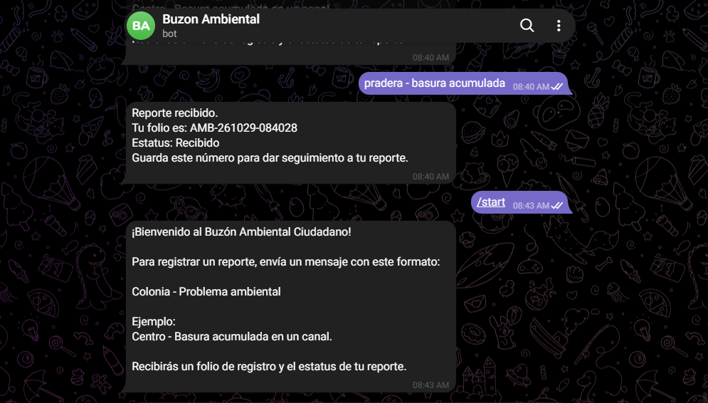
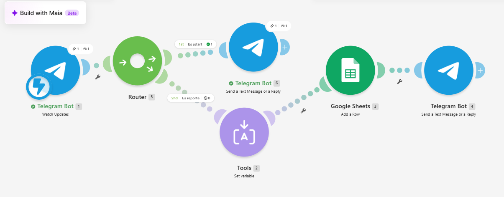

# Nombre del proyecto
BUZON AMBIENTAL

## Descripción
el objetivo de este codigo expone un chatbot en el que recibe reportes ambientales y los registra con todo y numero de folio.

## Objetivos de aprendizaje
 expone una automatizacion en make y consiste en recibir mensajes sobre reportes en un chatbot de telegram y utilizando una tabla en google sheets los registra.

## Material utilizado
Enumera todos los componentes usados:
- make
- telegram
- telefono
- laptop
- github
- google sheets
  

## Diagrama de la automatizacion

## Código
[ECOSISTEMA.blueprint](Codigo/Buzon_Ciudadano.blueprint.json)

## Video del funcionamiento

[Video](Video/Readme.txt)

[Ver video en YouTube]([https://youtu.be/IPo23v6J-c0](https://youtu.be/IPo23v6J-c0)

## Evidencias de la automatizacion

## Conclusiones
En conclusión, la automatización del Buzón Ambiental permite registrar y organizar reportes de manera rápida y eficiente mediante herramientas como Make, Telegram y Google Sheets. Este proyecto demuestra cómo la tecnología puede facilitar la comunicación, ahorrar tiempo y contribuir al cuidado del medio ambiente.

## Resultados
[resultados.pdf](Resultados/Resultados.docx)
