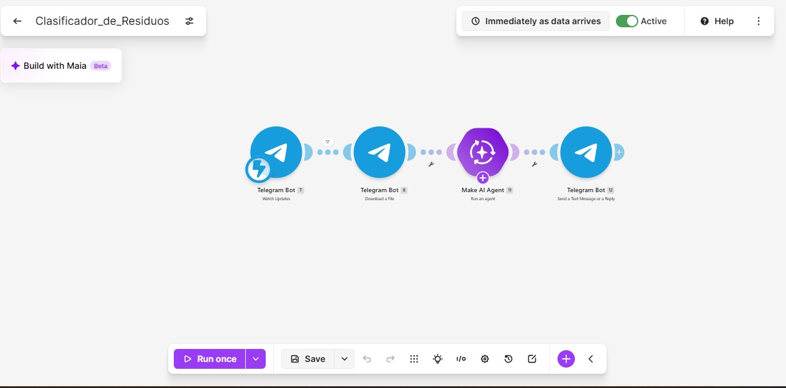
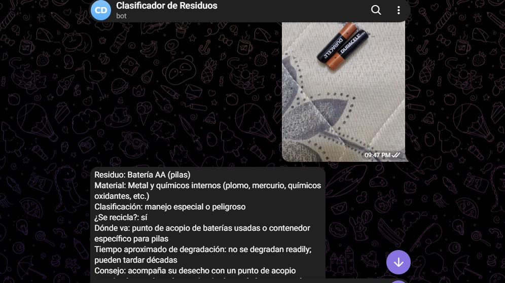

# Nombre del proyecto
CLASIFICADOR DE RESIDUOS 

## Descripción
el objetivo de este codigo expone un chatbot en el que recibe imagenes de residuos y los identifica .

## Objetivos de aprendizaje
 expone una automatizacion en make y consiste en recibir imagenes mediante un chatbot de telegram y utilizando inteligencia artificial para analizarlas e identificarlas.

## Material utilizado
Enumera todos los componentes usados:
- make
- telegram
- telefono
- laptop
- github
  

## Diagrama de la automatizacion

## Código
[Clasificador_de_Residuos.blueprint.json](Codigo/Clasificador_de_Residuos.blueprint.json)

## Video del funcionamiento

[Video](Video/Readme.txt)

[Ver video en YouTube]([https://youtu.be/2Gvs-D2Dexk](https://youtu.be/2Gvs-D2Dexk)

## Evidencias de la automatizacion

## Conclusiones
En conclusión, la automatización “Clasificador de Residuos” permite integrar Telegram e inteligencia artificial para facilitar la identificación y clasificación de residuos. Su implementación optimiza el proceso de aprendizaje y demuestra cómo la tecnología puede utilizarse de manera eficiente como apoyo en actividades educativas.

## Resultados
[resultados.pdf](Resultados/Resumen_Clasificador_Residuos_1_cuartilla.pdf)

