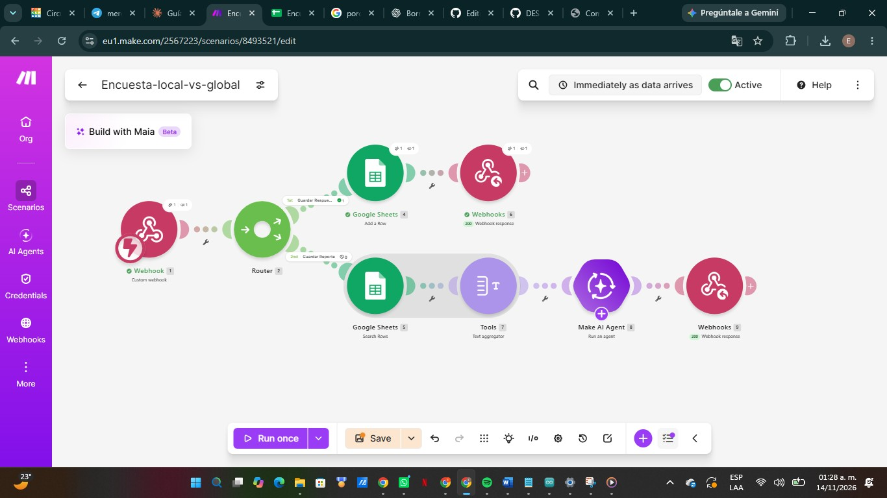
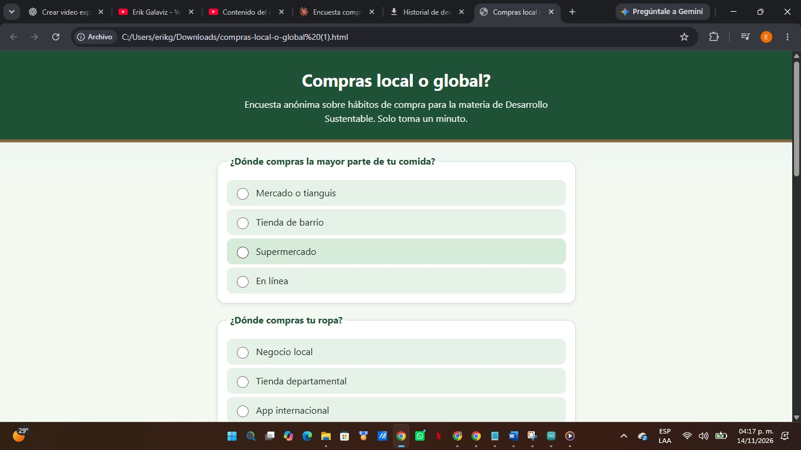
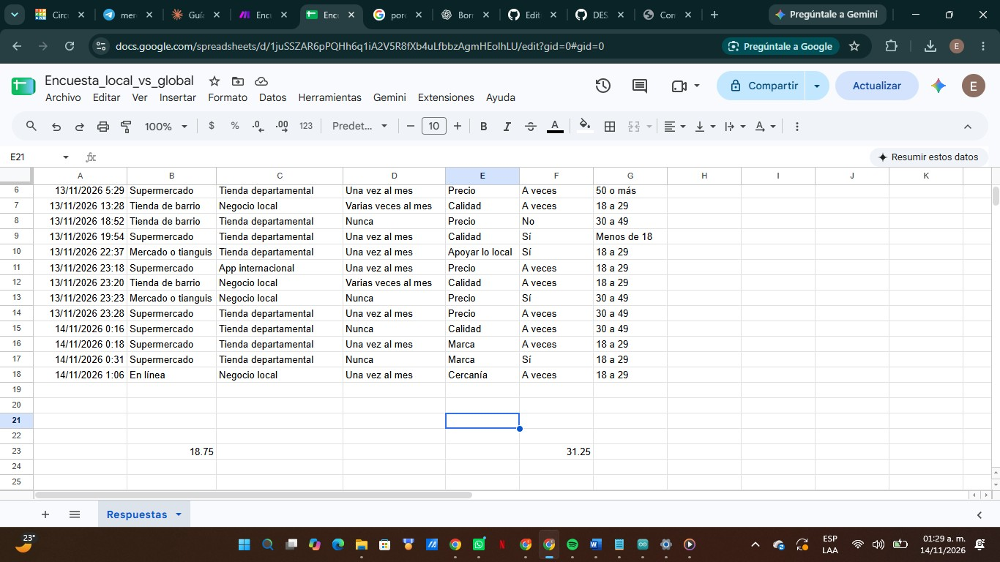

# Nombre del proyecto
ENCUESTA LOCAL O GLOBAL 

## Descripción
El objetivo de este proyecto es exponer un sistema de encuesta en línea que identifica los hábitos de compra local y global de la comunidad. Una página web envía las respuestas a Make, que las guarda en Google Sheets y, con un botón, una inteligencia artificial genera un reporte con porcentajes y conclusiones que el equipo verifica con fórmulas.

## Objetivos de aprendizaje
Exponer una automatización en Make que consiste en recibir las respuestas de una encuesta aplicada a 20 personas desde una página web publicada en GitHub Pages, guardarlas en Google Sheets y utilizar inteligencia artificial para analizarlas. Además, relacionar los hábitos de compra con la economía regional, el PIB y el impacto ambiental, y verificar que los resultados de la IA sean correctos.

## Material utilizado
Enumera todos los componentes usados:
- make
- telegram
- telefono
- laptop
- github
- google sheets
  

## Diagrama de la automatizacion

## Código
[Encuesta-local-vs-global.blueprint](Codigo/Encuesta-local-vs-global.blueprint.json)

## Video del funcionamiento

[Video](Video/Readme.txt) 

[Ver video en YouTube]([https://youtu.be/78M2vG-Ud8k](https://youtu.be/78M2vG-Ud8k))

## Evidencias de la automatizacion

## Conclusiones
En conclusión, la automatización "Encuesta ¿Compras local o global?" permite integrar una página web, Make, Google Sheets e inteligencia artificial para analizar los hábitos de compra de una comunidad y relacionarlos con la economía local, el PIB y el impacto ambiental. Su implementación demuestra cómo la tecnología puede apoyar el análisis de información y, a la vez, la importancia de verificar con fórmulas los resultados que entrega la IA.

## Resultados
[Resultados.pdf](Resultados/Resultados-Encuesta.pdf)

