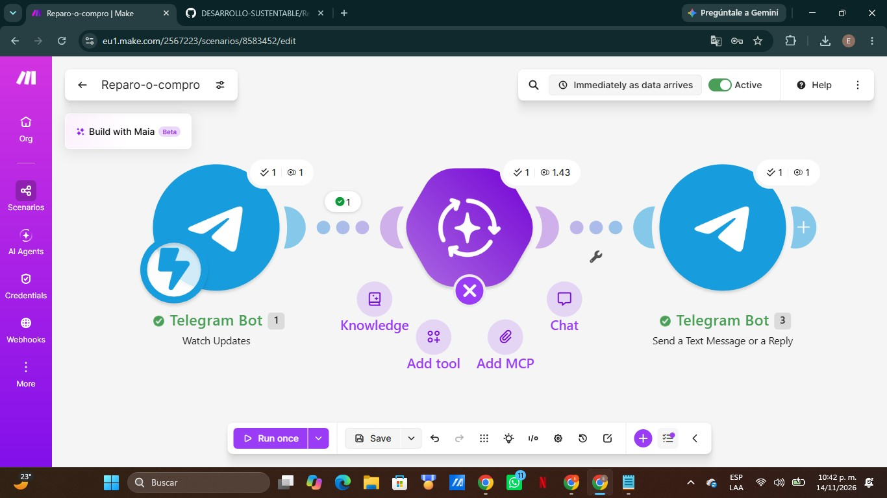

# Nombre del proyecto
BOT REPARO O COMPRO

## Descripción
El objetivo de este proyecto es exponer un chatbot de Telegram que recibe la descripción de un aparato con falla y, mediante inteligencia artificial, recomienda si conviene reparar, reemplazar, donar o reciclar. El bot indica la causa probable de la falla, el tipo de obsolescencia (planificada o percibida), si tiene reparación, un costo aproximado de reparar y de comprar uno nuevo en pesos mexicanos, y el impacto ambiental si se desecha.

## Objetivos de aprendizaje
Se expone una automatización en Make que consiste en recibir mensajes de texto mediante un chatbot de Telegram, filtrarlos y utilizar un agente de inteligencia artificial (Make AI Agent) para analizar el aparato y su falla. Con ello se busca distinguir la obsolescencia planificada de la percibida en casos reales, valorar la reparación como alternativa de consumo y verificar con información local (un taller de reparación de Mazatlán) las estimaciones que entrega la IA.

## Material utilizado
Enumera todos los componentes usados:
- make
- telegram
- telefono
- laptop
- github
  

## Diagrama de la automatizacion

## Código
[Reparo-o-compro.blueprint](Codigo/Reparo-o-compro.blueprint.json)

## Video del funcionamiento

[Video](Video/Readme.txt)

[Ver video en YouTube]([https://youtu.be/cl9x-oH7x34](https://youtu.be/cl9x-oH7x34)

## Evidencias de la automatizacion

## Conclusiones
En conclusión, la automatización "Reparo o Compro" permite integrar Telegram e inteligencia artificial para orientar la decisión de reparar o reemplazar un aparato con falla. Su implementación ayuda a identificar casos de obsolescencia planificada y percibida, fomenta la reparación como alternativa de consumo y reduce los residuos electrónicos, además de demostrar cómo la tecnología puede utilizarse de manera eficiente como apoyo en actividades educativas. La comparación con la cotización de un taller real de Mazatlán permitió comprobar qué tan cercanas son las estimaciones de la IA a la realidad local.

## Resultados
[Resultados-reparo-o-compro.pdf](Resultados/Resultados-reparo-o-compro.pdf)

