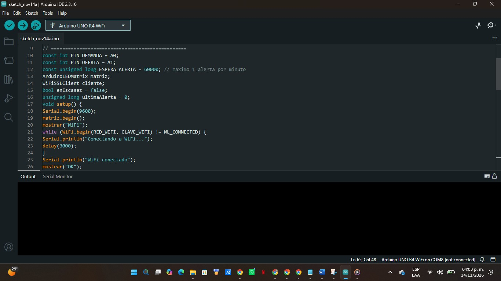

# Nombre del proyecto
SIMULADOR DE OFERTA Y DEMANDA 
## Descripción
el objetivo de este codigo expone un simulador físico de mercado del camarón. Dos potenciómetros representan la demanda y la oferta de un kilo de camarón; un Arduino UNO R4 WiFi calcula el precio de equilibrio, lo muestra en su matriz LED y, cuando detecta escasez (la demanda supera a la oferta), envía una alerta a Telegram mediante un webhook de Make..

## Objetivos de aprendizaje
Explicar cómo la oferta y la demanda fijan el precio de un producto.
Relacionar la escasez de un recurso natural (por ejemplo, una veda de camarón) con su precio.
Construir un sistema IoT que convierte un fenómeno económico en datos y alertas automáticas.
Conectar un Arduino con Make mediante un webhook y enviar mensajes por un bot de Telegram.

## Material utilizado
Enumera todos los componentes usados:
- Arduino UNO R4 WiFi con cable USB-C
- 2 potenciómetros de 10 kΩ
- Protoboard y cables jumper
- Computadora con Arduino IDE (librerías ArduinoGraphics y Arduino_LED_Matrix)
- Red WiFi de 2.4 GHz con usuario y contraseña
- Make (Webhooks y Telegram Bot)
- Telegram (BotFather) en el celular
- GitHub
  

## Diagrama de la automatizacion

## Código
[Simulador-oferta-demanda.zip](Codigo/Simulador-oferta-demanda.zip)

## Video del funcionamiento

[Video](Video/Readme.txt)

[Ver video en YouTube]([https://youtu.be/l0iQL7BLzcA](https://youtu.be/l0iQL7BLzcA))

## Evidencias de la automatizacion

## Conclusiones
En conclusión, el simulador permite observar cómo la oferta y la demanda determinan el precio de un recurso como el camarón: cuando la oferta baja o la demanda sube, el precio aumenta y se genera una alerta de escasez. La integración de Arduino, Make y Telegram muestra cómo la tecnología convierte un fenómeno económico en datos y avisos automáticos útiles para un productor o una cooperativa. Como limitación, el modelo es lineal y no considera factores reales como el clima, el costo del combustible, las importaciones ni el costo ambiental de producir camarón.

## Resultados
[Resultados-Simulador.pdf](Resultados/Resultados-Simulador.pdf)

